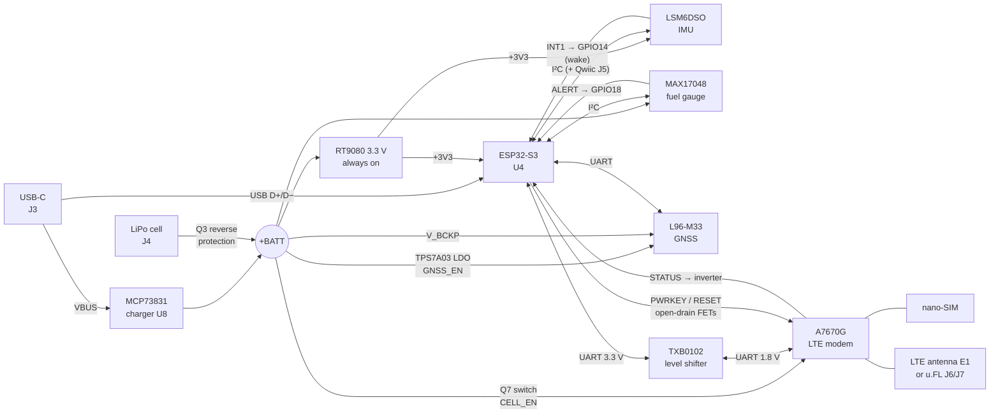
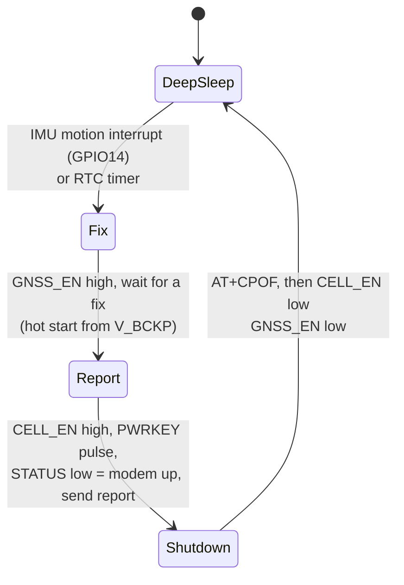

# BWLC1A: Low-power Cellular GPS Tracker


BWLC1A is a small, low-cost tracker board from Teapot Laboratories. It reports its position over LTE Cat-1 and is
meant to run for **at least a year on one battery**. To get there it spends almost all of its time in deep sleep,
wakes up when the accelerometer feels movement, takes a GNSS fix, sends a report over the cellular network, and goes
back to sleep with the modem and GNSS fully powered off.

| | |
|---|---|
| **Revision** | Rev 4 (branch `r4`). Design complete; not yet built or measured. |
| **Controller** | Espressif ESP32-S3-MINI-1-N4R2 (U4): Wi-Fi, Bluetooth LE, USB, deep sleep with RTC wake |
| **Cellular** | SIMCom A7670G-LABE (U1), LTE Cat-1, nano-SIM (J1) |
| **GNSS** | Quectel L96-M33 (U3), GPS / GLONASS / Galileo / BeiDou, built-in antenna, battery-backed hot starts |
| **Motion wake** | ST LSM6DSO 6-axis IMU (U11), INT1 to an RTC-capable ESP32 pin |
| **Battery** | Single-cell LiPo on a JST-PH 2-pin connector (J4), MAX17048 fuel gauge (U10) |
| **Charging** | USB-C (J3), MCP73831 linear charger (U8), 500 mA |
| **LTE antenna** | TE 2108784-1 PCB antenna (E1), or a u.FL connector (J6/J7) selected by resistors |
| **Expansion** | Qwiic / STEMMA QT I²C connector (J5), Tag-Connect TC2050 JTAG pads (J2), reset and boot buttons (SW1, SW2) |
| **Board** | 83.85 × 50.1 mm, 4 layers, 1.6 mm, 50 Ω coplanar antenna feed, all parts on the top side |

## Gallery

| Top | Bottom |
|---|---|
|  |  |
|  |  |

<p align="center"></p>

## Architecture



### Power

Everything runs from the single-cell battery rail **+BATT**. While the tracker sleeps, only the 3.3 V regulator and
what it feeds (ESP32, IMU, the idle TXB0102 B side), the fuel gauge and the GNSS backup domain are powered.

| Rail | Source | Feeds | Switched by |
|---|---|---|---|
| +BATT | LiPo through Q3 (PMV32UP, reverse protection); charged by U8 from USB | everything below | always on |
| +3V3 | U6 RT9080-33 LDO | ESP32-S3, LSM6DSO, TXB0102 B side, Qwiic J5 | always on |
| CELL_BATT | +BATT through Q7 (PMV32UP P-FET), driven by Q8 (2N7002) | A7670G VBAT (soft start ~15 ms) | CELL_EN, GPIO13 |
| GNSS_3V3 | U7 TPS7A0333 LDO | L96-M33 VCC | GNSS_EN, GPIO4 |
| V_BCKP | +BATT directly | L96-M33 backup (keeps ephemeris for hot starts) | always on |
| VDD_1V8 | A7670G output | TXB0102 A side | on while the modem is on |

The modem draws up to about 2 A in bursts, so it takes its supply straight from the battery through a P-FET switch
rather than through a regulator.

### Operating cycle



### Estimated sleep budget

Datasheet typical values, **not measured yet**. Details and sources are in the
[Rev 4 change report](docs/worklog/2026-11-19-rev4-changes.html).

| In deep sleep | Current |
|---|---|
| ESP32-S3, RTC on for wake | 8 µA |
| LSM6DSO, low-power wake-up mode | 4.4 to 9.5 µA |
| L96-M33 backup domain | 7 µA |
| MAX17048, hibernate | 3 to 5 µA |
| RT9080 quiescent | 2 µA |
| TXB0102, charger, switched-off regulators, ESD | ≤ 4 µA |
| **Total** | **about 27 to 40 µA, about 240 to 350 mAh per year** |

With an assumed 1.5 mAh per wake-up (about 20 s GNSS fix plus 30 s LTE report), four wake-ups a day fit a 3 to 4 Ah
LiPo for one year. Measure sleep and event current on the first boards before choosing the cell.

## ESP32-S3 pin map

| GPIO | Net | Use |
|---|---|---|
| GPIO0 | BOOT_MODE0 | Boot strap, BOOT button SW2 |
| GPIO1 | GNSS_RESET | L96 reset, **drive open-drain only** (no pull-up) |
| GPIO4 | GNSS_EN | GNSS LDO enable |
| GPIO5 | GNSS_FO | L96 force-on |
| GPIO6 | GNSS_EXTINT | L96 external interrupt |
| GPIO7 / GPIO8 | GNSS_RXD / GNSS_TXD | GNSS UART |
| GPIO9 | CELL_PWRKEY | Modem PWRKEY through Q4, active high |
| GPIO10 / GPIO11 | CELL_TXD / CELL_RXD | Modem UART through the TXB0102 |
| GPIO12 | CELL_RESET | Modem RESET through Q5, active high |
| GPIO13 | CELL_EN | Modem battery switch Q7 |
| GPIO14 | IMU_INT | LSM6DSO INT1, deep-sleep wake source |
| GPIO17 | CELL_STATUS_N | Modem STATUS through the Q6 inverter, **low = modem on** |
| GPIO18 | FG_INT | MAX17048 ALERT |
| GPIO19 / GPIO20 | USB_D− / USB_D+ | Native USB on the USB-C connector |
| GPIO21 | GNSS_STAT | L96 status |
| GPIO36 / GPIO37 | SCL / SDA | I²C: IMU, fuel gauge, Qwiic J5 |
| GPIO39 to GPIO42 | JTAG_TCK / TDO / TDI / TMS | Tag-Connect J2 |
| GPIO47 / GPIO48 | LEDs | D6 / D5 |
| EN | CHIP_EN | Reset button SW1, Tag-Connect J2 |

### Firmware notes

- PWRKEY and RESET are pulled up to VBAT inside the modem. They are driven only through the Q4 and Q5 open-drain
  N-FETs, which are active high. Never assert both at the same time (A7670 hardware design guide).
- Before switching the modem off with CELL_EN, send `AT+CPOF`. Wait at least 5 s before switching it on again.
- GNSS_RESET has no pull-up: drive GPIO1 open-drain only.
- The modem UART is 1.8 V on the modem side. The TXB0102 translates it and goes high-impedance while the modem's
  1.8 V rail is off, so nothing back-powers the modem.

## Schematic


The KiCad 10 project is in [`hardware/kicad/`](hardware/kicad): the root sheet `bwlc1a.kicad_sch` plus eight
sub-sheets (Power, Battery, USB and Charger, Main Controller, Cellular, GNSS, Sensors, Antenna), the board
`bwlc1a.kicad_pcb`, and project libraries in `library/`.

## Manufacturing

Production files are in [`hardware/kicad/production/`](hardware/kicad/production):

| File | Contents |
|---|---|
| `TeapotlabsBWLC1A_Gerber.zip` | Gerbers, PTH/NPTH drill, IPC-D-356 netlist, PCBWay BOM and positions |
| `TeapotlabsBWLC1A_BOM.csv` | Bill of materials: 53 lines, 112 parts, with LCSC part numbers |
| `TeapotlabsBWLC1A_CPL.csv` | Pick-and-place positions (top side only) |
| `TeapotlabsBWLC1A_ManufacturingInfo.txt` | Board spec, stack-up and impedance notes for the fab |
| `TeapotlabsBWLC1A_InteractiveBOM.html` | Interactive BOM for hand assembly and inspection (open in a browser) |

Board spec: 4 layers, 1.6 mm, S1000H TG150, 5/5 mil, 0.3 mm minimum hole, tented vias, red solder mask with white
silkscreen. The LTE antenna feed is a 50 Ω coplanar waveguide on L1 (0.33 mm trace, 0.2 mm gap, referenced to L2),
so order with impedance control. The interactive BOM is rebuilt from the board, BOM and CPL with
[`hardware/tools/ibom/make_ibom.py`](hardware/tools/ibom/make_ibom.py).

## What changed in Rev 4

- **Modem UART translator:** the 4-channel TXB0104 became a 2-channel TXB0102. Modem RESET now has its own open-drain
  driver (Q5) on GPIO12.
- **Modem STATUS:** the 1.8 V STATUS output is read through a FET inverter (Q6), so GPIO17 sees a clean 3.3 V level.
- **Modem power:** the SY8089 buck is gone. The modem runs straight from the battery through a P-FET switch with a
  soft start.
- **GNSS:** the reset pull-up that back-fed current in sleep is removed. The GNSS backup supply is wired straight to
  the battery, so every fix is a hot start; the backup switch and jumper are gone.
- **Assembly:** the battery connector moved to the top, so the board is single-sided. The corner is cut away for the
  battery cable.
- **Schematic readability** and a refreshed set of production files.

The full report with before/after schematic, PCB and 3D views is
[`docs/worklog/2026-11-19-rev4-changes.html`](docs/worklog/2026-11-19-rev4-changes.html). Download or clone the
repository and open it in a browser; GitHub shows HTML files as source.

## Repository layout

```
hardware/
  kicad/          KiCad 10 project, libraries, 3D models
    production/   Gerbers, BOM, CPL, manufacturing notes, interactive BOM
  tools/ibom/     Interactive BOM generator
docs/
  images/         README images and report images (Git LFS)
  worklog/        Design change reports
```

Images under `docs/images/` and the 3D models are stored with [Git LFS](https://git-lfs.com). Install it before
cloning to get the files instead of pointer stubs.

## License

[MIT](LICENSE)
